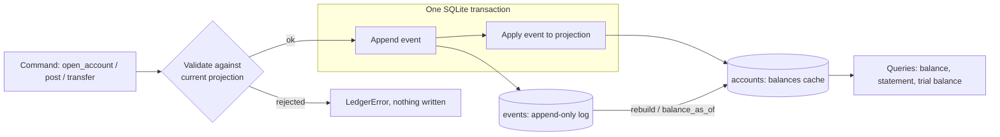

# event-sourced-ledger

A double-entry accounting ledger where the append-only event log is the only source of truth. Balances are a cache that can be deleted and rebuilt from the log at any time.

No runtime dependencies. Python 3.10+, SQLite.

## Why event sourcing fits money

A normal CRUD table stores the current balance and overwrites it. If a bug writes the wrong number, the right one is gone. Here nothing is ever overwritten: every change is a new event, and the balance is whatever the events add up to. That gives an audit trail for free, lets you ask "what was the balance last Tuesday?", and means a corrupted balance table is a non-event.

## Guarantees and how each is tested

| Guarantee | Mechanism | Test |
|---|---|---|
| Money is never created or destroyed | A transaction is rejected unless its debits equal its credits | 4 malformed shapes rejected; `trial_balance()` is 0 after every scenario |
| All legs post, or none do | One SQLite write transaction covers validation, the event and the projection | an overdraft on one leg leaves the log and balances untouched |
| No overdrafts under concurrency | The limit check and the write happen under the same write lock | 8 threads request 4,000 from an account holding 1,000; exactly 1,000 moves |
| History cannot be rewritten | Database triggers abort any `UPDATE` or `DELETE` on the event table | `test_events_cannot_be_edited_or_deleted` |
| Retried requests post once | Idempotency keys are stored in the event, so they survive a rebuild | `test_idempotency_key_posts_once`, and again after `rebuild()` |
| Balances can always be recovered | `rebuild()` replays the log into an empty projection | the test corrupts a balance on purpose, rebuilds, and compares |
| Lost updates are caught | Appends carry an expected stream version | `test_optimistic_concurrency_on_a_stream` |

## Architecture



The projection is updated in the same transaction as the event, so reads are never stale. This trades the scalability of asynchronous projections for simplicity and strong consistency, which is the right default for a ledger.

## Use it

```python
from ledger import Ledger, EventStore, Entry

ledger = Ledger(EventStore("ledger.db"))
ledger.open_account("bank", "Cash at bank", normal="debit")
ledger.open_account("alice", "Alice's wallet", normal="credit", min_balance=0)   # we owe Alice; no overdraft
ledger.open_account("fees", "Fee revenue", normal="credit")

ledger.post([Entry("bank", debit=50_000), Entry("alice", credit=50_000)], "deposit", idempotency_key="dep-1")
ledger.post([Entry("alice", debit=1_010), Entry("bank", credit=1_000), Entry("fees", credit=10)], "withdrawal + fee")

ledger.balance("alice")              # 48_990
ledger.balance_as_of("alice", 4)     # 50_000: the balance after event 4
ledger.statement("alice")            # every line with a running balance
```

Amounts are integers in minor units (paise, cents). Floats are rejected.

## Demo

`python -m ledger` opens 5 customer wallets, attempts 500 random payments with a 1% fee, then deletes and rebuilds the balances from the log. Output from a run (the random seed is fixed, so yours will match):

```json
{
  "payments_posted": 393,
  "payments_rejected_insufficient_funds": 107,
  "events_in_log": 405,
  "events_replayed_on_rebuild": 405,
  "projection_matches_after_rebuild": true,
  "trial_balance": 0
}
```

The books close: the five wallets plus fee revenue sum to exactly the 500,000 deposited at the bank.

## Run it

```bash
pip install -e ".[dev]"
pytest -q            # 13 tests
python -m ledger

docker build -t ledger . && docker run --rm ledger
```

## Trade-offs and what is missing

- **Replay cost grows with the log.** `balance_as_of` and `rebuild` read from the start. Snapshots every N events would bound that; they are not implemented.
- **Single-node.** SQLite serialises writers. The same design maps to PostgreSQL with a unique `(stream, version)` constraint for multi-node writes.
- **No multi-currency.** Every account is assumed to share one currency.
